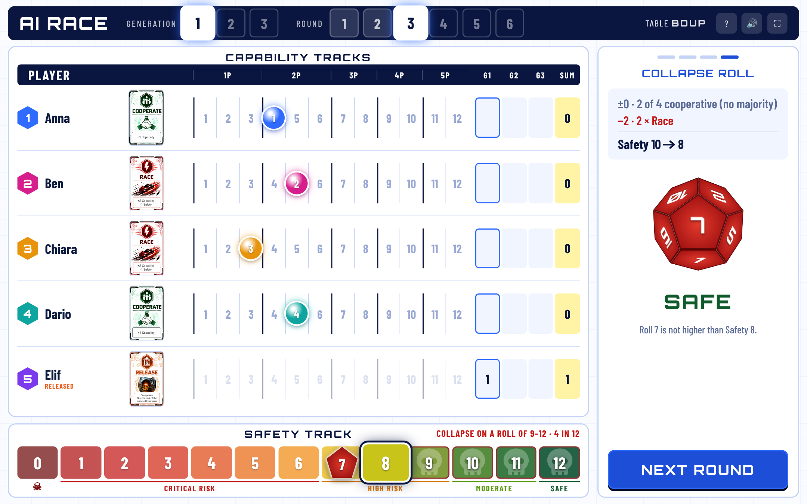

# AI Race Game – digital version

Digital table version of the *AI Race Game* by Naoki Peter (CC BY-SA 4.0).
One big screen per table shows the board; every player uses their phone as a hand of cards.
Rules and design decisions: see [SPEC.md](SPEC.md).



## Run

Needs Node.js 18 or newer. No `npm install`, no database.

```
node server.js
```

Open `http://localhost:3000` on the big screen and tap **Host a table**. Players scan the
QR code with their phones. All phones must be able to reach the server:

- **Same Wi-Fi**: the lobby shows the laptop's network address automatically. Many school
  networks block connections between devices; in that case use the next option.
- **Internet**: put this folder on any Node host (Render, Fly.io, Railway, a school server)
  with start command `node server.js`. The port is taken from the `PORT` variable.
  Use one instance only – games are kept in the memory of that one process.

A server restart ends all running games.

## Files

| | |
|---|---|
| `server.js` | web server, rooms, live updates (Server-Sent Events) |
| `game.js` | the rules – change rule decisions here |
| `test/game.test.js` | rule tests, run with `node --test` |
| `public/host.*` | big screen |
| `public/play.*` | phone |
| `public/img` | card images, cropped from `../cards.png` |

Tip for trying things out: `/host?room=ABCD&speed=0.2` makes the big-screen animations
five times faster.

## Licences

Game and this adaptation: CC BY-SA 4.0 (Naoki Peter). QR code generator: Kazuhiko Arase, MIT.
Fonts Orbitron, Barlow and Barlow Condensed: SIL Open Font License 1.1.
